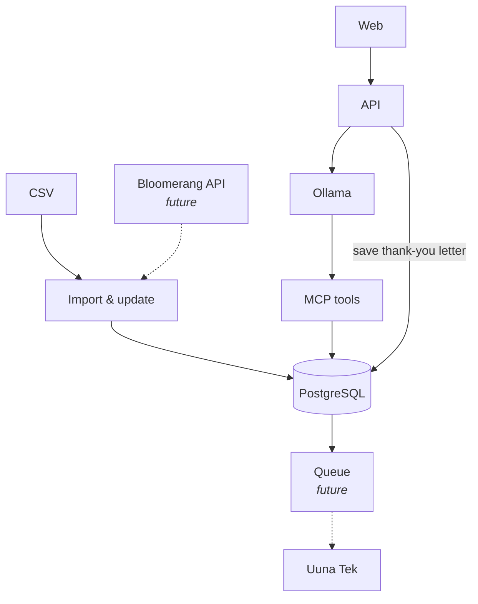

# Handwritten — Phoenix Bikes thank-you notes

## High-level diagram

1. Data from CSV and Excel sources (Bloomerang API in the future) is imported and updated into PostgreSQL.
2. When a thank-you letter is created (web → api), the API sends a request to Ollama, and Ollama calls the MCP tools.
3. The generated thank-you letter is saved.
4. The letter is handed to Uuna Tek through a queue (future).

## Tech stack

| Layer | Technology |
|-------|-----------|
| Web | Qwik City (TypeScript, Vite, SSR) |
| API | Python, FastAPI, SQLAlchemy (async), Alembic |
| Database | PostgreSQL 17 |
| LLM | Ollama (llama3.2 for letters, gemma3 for vision) |
| MCP | FastMCP — mounted in the API at `/mcp`, also runs over stdio |
| Infra | Docker Compose (db, api, web, optional ollama) |

## MCP tools

| Tool | Description |
|------|-------------|
| `search_donors` | Search donors by name, email or Bloomerang account number |
| `get_donor` | Get a donor with their giving summary, most recent gifts and all thank-you notes |
| `get_donor_summary` | Giving totals for one donor: gift counts, direct vs Raise + Ride, last gift, last note |
| `list_donor_summaries` | List donor giving summaries with optional filters |
| `update_donor_address` | Update a donor's mailing address |
| `list_gifts` | List gifts, filter by donor, channel (direct / raise_ride) and date range |
| `find_eligible_gifts` | This week's thank-you candidates: at most one gift per donor |
| `get_gift_context` | Facts for drafting a thank-you note for one specific gift |
| `list_notes` | List thank-you notes, newest first |
| `get_note` | Get one thank-you note with the donor's name/address and the gift it thanks |
| `create_note_draft` | Create a draft thank-you note for a donor |
| `update_note_draft` | Replace the text of a draft note |
| `reject_note` | Reject a draft or approved note |
| `approve_note` | Staff only: approve a draft note |
| `mark_note_sent` | Staff only: mark an approved note as mailed |
| `list_import_batches` | List past imports with row/donor/gift counts |
| `import_gifts_csv` | Staff only: import a Bloomerang gift export given as CSV text |
| `list_documents` | List the most recent documents |
| `get_document` | Get a single document by id |
| `create_document` | Create a new document |
| `search_documents` | Search documents by title and content |

## Badges

| Badge | Rule |
|-------|------|
| Lantern | The note with the gift says "in memory" / "in honor" |
| First Gear | The donor's first direct gift |
| Headlight | Returning: previous direct gift 365+ days earlier |
| Spoke Star | Gives directly and rides Raise + Ride |
| Chain Keeper | 3+ direct gifts over 2+ calendar years |
| Tailwind | Quick follow-up: previous direct gift within 60 days |
| Kickstand | Everything else |

## Contributors

1. nasaaski — Nasan-Ochir Lkhagvasuren
2. ilyascokan — Ilyas Cokan
3. magnaibayarmn — Magnaibayar Ganzorig
